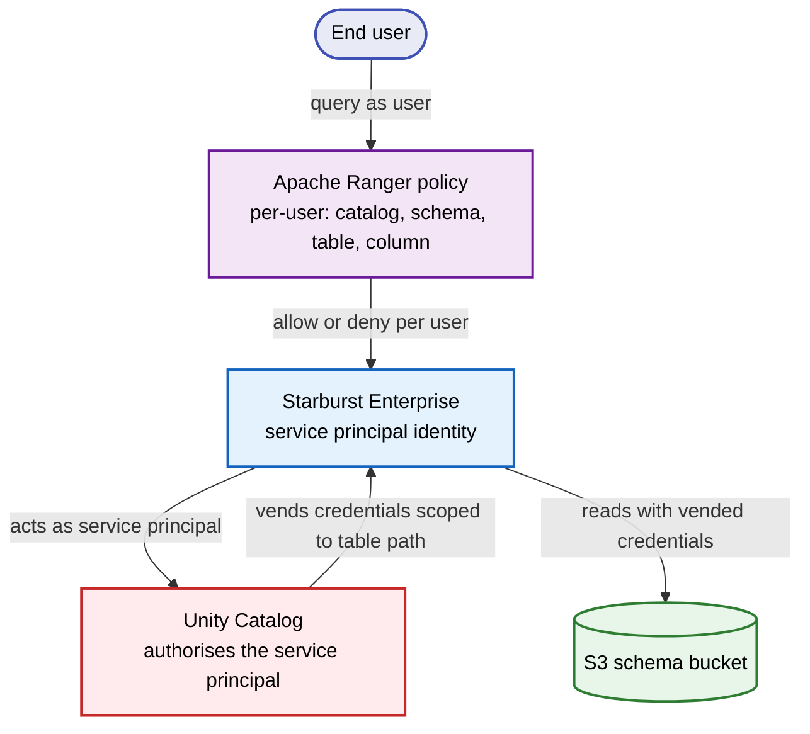
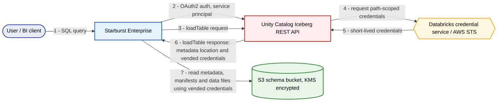
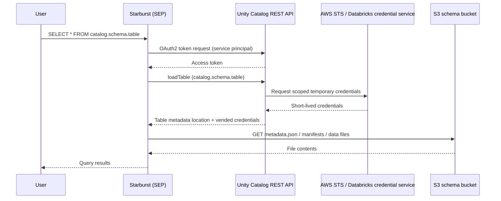
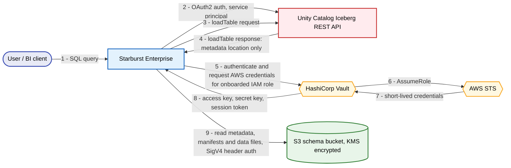
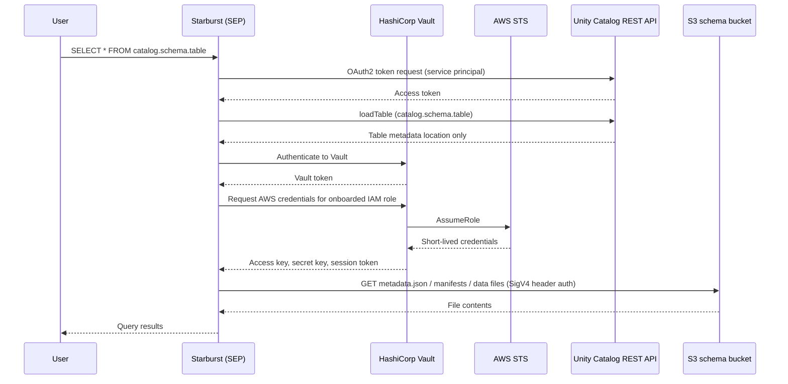
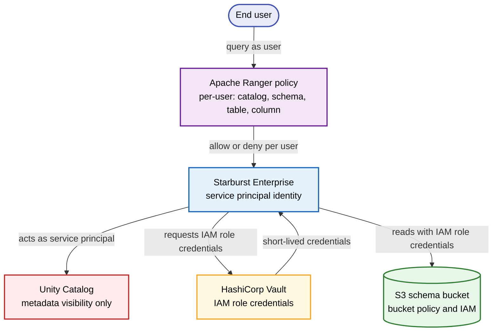

# Starburst to Databricks Unity Catalog: Iceberg Access Patterns

> Status: draft for review by the threat modelling and cloud engineering teams.
> Last updated: 2026-09-18

## Contents

- [Summary](#summary)
- [Background](#background)
  - [The integration](#the-integration)
  - [Separating metadata from storage](#separating-metadata-from-storage)
  - [What is already certified](#what-is-already-certified)
- [Pattern one: Databricks Unity Catalog credential vending](#pattern-one-databricks-unity-catalog-credential-vending)
- [Pattern two: HashiCorp Vault credentials](#pattern-two-hashicorp-vault-credentials)
- [Validation status](#validation-status)
- [Open questions and asks](#open-questions-and-asks)

---

## Summary

Starburst Enterprise needs to read Databricks-managed Iceberg tables registered in Unity Catalog. Unity Catalog holds the metadata; the table data and metadata files themselves live in an S3 schema bucket. Two things therefore have to work: Starburst must authenticate to Unity Catalog to discover tables, and Starburst must authenticate to S3 to read the underlying files.

Storage access is the open question, and there are two candidate patterns:

**Pattern one — Databricks Unity Catalog credential vending.** Unity Catalog issues short-lived storage credentials to Starburst on demand. Access control is centralised in Databricks; Starburst holds no standing bucket credentials.

**Pattern two — HashiCorp Vault credentials.** Starburst obtains short-lived AWS STS credentials from Vault against an onboarded IAM role, and uses them to read S3 directly. Unity Catalog is used for metadata only. This is the mechanism our existing certified Iceberg-on-S3 pattern already uses.

---

## Background

### The integration

The Starburst Iceberg connector reads Iceberg tables with Databricks Unity Catalog as the metastore. Unity Catalog exposes an Iceberg REST endpoint, and Starburst is configured to treat that endpoint as its catalog.

The baseline catalog configuration, per Starburst documentation, is:

```properties
connector.name=iceberg
iceberg.catalog.type=rest
iceberg.rest-catalog.uri=https://<workspace>.cloud.databricks.com/api/2.1/unity-catalog/iceberg-rest
iceberg.rest-catalog.security=OAUTH2
iceberg.rest-catalog.oauth2.token=<OAUTH_TOKEN>

# Required for pattern one; do not set for pattern two.
iceberg.rest-catalog.vended-credentials-enabled=true
```

In our deployment, authentication to Unity Catalog uses a Databricks service principal with a client ID and client secret rather than a static personal access token.

### Separating metadata from storage

It is important to keep two distinct channels in mind, because the two patterns differ only in the second:

1. **Metadata channel.** Starburst to the Unity Catalog Iceberg REST API, over HTTPS, authenticated with OAuth2. This returns catalog, schema and table listings, and for a given table the location of its metadata file.
2. **Storage channel.** Starburst to Amazon S3, to read the Iceberg metadata files, manifest files and Parquet data files. This requires AWS credentials and is subject to the bucket policy and KMS key policy on the schema bucket.

The metadata channel is identical in both patterns. The storage channel is what pattern one and pattern two answer differently.

### What is already certified

Our organisation has already certified the Starburst Iceberg connector reading Iceberg tables from a standard AWS S3 bucket, using HashiCorp Vault to supply credentials. That pattern is in production use today for Iceberg tables that are not Databricks-managed.

What is new here is pointing that same proven machinery at a Databricks-managed schema bucket.

---

## Pattern one: Databricks Unity Catalog credential vending

### In plain terms

Starburst asks Unity Catalog for a table. Along with the table's location, Unity Catalog hands back a set of temporary AWS credentials scoped to just that table's storage path. Starburst uses those credentials to read the files, and they expire shortly afterwards.

The appeal is that access control lives in one place. Databricks decides who can read what, and Starburst never holds standing credentials to the bucket. Per Databricks documentation, credential vending grants short-lived credentials through the Unity Catalog REST API, and those credentials inherit the privileges of the Databricks principal used to configure the integration.

### Authorisation model

Authorisation is enforced in Starburst, as in pattern two: Apache Ranger governs which catalogs, schemas, tables and columns each user can reach at query time. Unity Catalog sees only the service principal, not the querying user, so the credentials it vends are scoped to what that principal may read. Those credentials are limited to the table's storage path and expire shortly afterwards, so the engine holds no standing access to the bucket.



### Data flow





### What this requires

- External data access enabled on the Unity Catalog metastore. This is a metastore-level setting, disabled by default, and only a metastore admin can turn it on. Without it, no external engine can read data regardless of schema-level grants.
- A Databricks service principal with the appropriate Unity Catalog privileges on the catalog, schema and tables, plus `EXTERNAL USE SCHEMA` where required for external engine access.
- A Databricks external location and storage credential giving Unity Catalog access to the schema bucket and its KMS key. This is already in place, as tables can be created in this bucket from the Databricks workspace. What remains unconfirmed is whether that access can be extended to an external engine, which is a separate grant.
- Network egress from the Starburst cluster to the Databricks workspace REST endpoint and to S3.
- A bucket policy and KMS key policy that permit the role Databricks assumes on our behalf.

### Connector configuration

Vending is enabled on the Iceberg connector with:

```properties
iceberg.rest-catalog.vended-credentials-enabled=true
```

Starburst documents this property under server-side scan planning rather than under general configuration. Server-side scan planning is the mode in which Databricks Unity Catalog, rather than SEP, determines which data files satisfy a query, and it is required to enforce Unity Catalog fine-grained access control such as column masks and row filters. SEP uses it automatically when the REST catalog advertises it for a table, and it depends on vended credentials to read the files returned during planning.

---

## Pattern two: HashiCorp Vault credentials

### In plain terms

Unity Catalog is used purely as a metadata service. When Starburst needs to read files from S3, it does not ask Databricks for credentials. Instead Starburst authenticates to HashiCorp Vault, which returns short-lived AWS STS credentials for an IAM role that has been onboarded to Vault. Starburst then signs its S3 requests with those credentials. All outbound communication in this pattern originates from the Starburst instance.

This is the mechanism already certified in our environment. It was originally implemented for the Hive-based file system; Starburst has since implemented support for the native S3 file system, which supports the same credential retrieval approach.

Vault credentials are stored as secrets and never appear in the catalog properties file in plain text.

### Data flow





### What this requires

- An IAM role onboarded to HashiCorp Vault, with read access to the schema bucket and decrypt access to the associated KMS key.
- Credentials for the Starburst cluster to authenticate to Vault, held as secrets.
- The S3 bucket policy amended to permit this IAM role to read the schema bucket.
- Network egress from the Starburst cluster to Vault, to AWS STS and to S3.
- Unity Catalog privileges for the service principal sufficient for metadata reads only.

### Authorisation model

Authorisation is enforced in Starburst. Apache Ranger governs entitlements on this cluster, so which catalogs, schemas, tables and columns a user can reach is decided by Ranger policy at query time. The IAM role obtained from Vault is used by the engine to read files, not by end users, who have no direct access to it or to the bucket.

Unity Catalog privileges still govern what the service principal can see in the metadata channel, so the two layers work together: Unity Catalog bounds what the catalog exposes, and Ranger governs what each user may query. The credential path is one we already operate, monitor and have certified, and it does not depend on Databricks internals that we have limited visibility into.



---

## Validation status

### What works today

Connectivity from Starburst to Unity Catalog is confirmed. Using the Databricks service principal over OAuth2, we can expand a catalog and see its schema names, and expand a schema and see its table names. The metadata channel is therefore functioning end to end.

Separately, the Vault credential path has been validated by hand, outside Starburst. Using curl we retrieved credentials from Vault, and using the AWS CLI with those STS credentials we listed the contents of the bucket, downloaded an Iceberg metadata file and read its contents. KMS decrypt access for the role was confirmed in the same exercise.

### What does not work yet

Querying table data fails. The failure is at the S3 layer, not in the Starburst configuration.

When a query is issued, the request that reaches S3 for the Iceberg metadata file arrives with query-string authentication rather than header-based authentication. The bucket policy on the schema bucket restricts the accepted authentication type to header-based signing, so the `GetObject` request is denied.

Query-string authentication is characteristic of presigned URLs. Our organisation restricts presigned URL creation on schema buckets, permitting it only on the root bucket. That restriction is what the request is running into.

The practical consequence is the split we see today: schema and table names resolve because they come from the Databricks metastore over the REST API, but a query fails because it must traverse S3 directly.

### Status by pattern

Pattern one is not validated. The presigned URL restriction is currently blocking it, and it is not yet established how Databricks issues credentials for this path or whether the resulting requests would use query-string or header-based authentication.

Pattern two is not yet validated against the Databricks-managed schema bucket, and is not yet wired into Starburst for this catalog. However, the underlying pattern — the Starburst Iceberg connector reading Iceberg tables from a standard AWS S3 bucket with Vault-supplied credentials — is already certified and in use. The components are proven; what is untested is aiming them at this particular bucket.

---

## Open questions and asks

We are presenting this from the Starburst engineering side. We have good visibility into the Starburst configuration and the Vault credential path, and limited visibility into how the Databricks control plane connects to S3, how it evaluates policy, and what privileges it requires. Several of the questions below need input from teams closer to Databricks and to cloud infrastructure.

### For the cloud engineering team

- Can the schema bucket policy permit header-based SigV4 requests from a nominated IAM role, so that pattern two can be tested against this bucket?
- Is there scope to relax the presigned URL restriction on schema buckets, or is the root-bucket-only rule fixed? This determines whether pattern one is viable at all.
- Which KMS keys protect the schema bucket, and what key policy changes would each pattern require?

### For the threat modelling team

- Both patterns use short-lived credentials, but from different issuers: Databricks in pattern one, Vault in pattern two. Which issuer better fits our control expectations?
- In both patterns, Unity Catalog sees only the service principal, not the querying user. Per-user entitlements are enforced by Ranger in Starburst. Does that division meet our expectations?
- In pattern one, vended credentials inherit the privileges of the Databricks principal configuring the integration. Does that indirection meet our least-privilege requirements?

### For Databricks or platform colleagues

- How does the Databricks control plane sign its S3 requests when vending credentials, and can it be made to use header-based authentication?
- Is credential vending for the Iceberg REST endpoint enabled on our workspace, and what external location and storage credential configuration does it depend on?

### For Starburst support

- Confirm that server-side scan planning and its latency and feature limitations are acceptable for our workloads, given that vended credentials are tied to it.

### Suggested next steps

1. Confirm the vending property and server-side scan planning behaviour on our SEP version.
2. Request a bucket policy exception for a nominated IAM role so pattern two can be tested end to end against the schema bucket.
3. In parallel, establish with Databricks whether the presigned URL behaviour can be avoided, which decides whether pattern one remains on the table.
4. Return to the threat modelling team with test results for whichever paths prove technically viable.

---

## Notes on rendering in Confluence

- Confluence Cloud converts Markdown on paste, so headings, lists and code blocks should carry over.
- Mermaid blocks will paste as plain code. To render them, use a Mermaid macro from the Atlassian Marketplace, or paste each block into the Mermaid live editor and insert the resulting image.
- The `properties` language hint on config blocks can be changed to `text` if your Confluence code macro does not recognise it.
